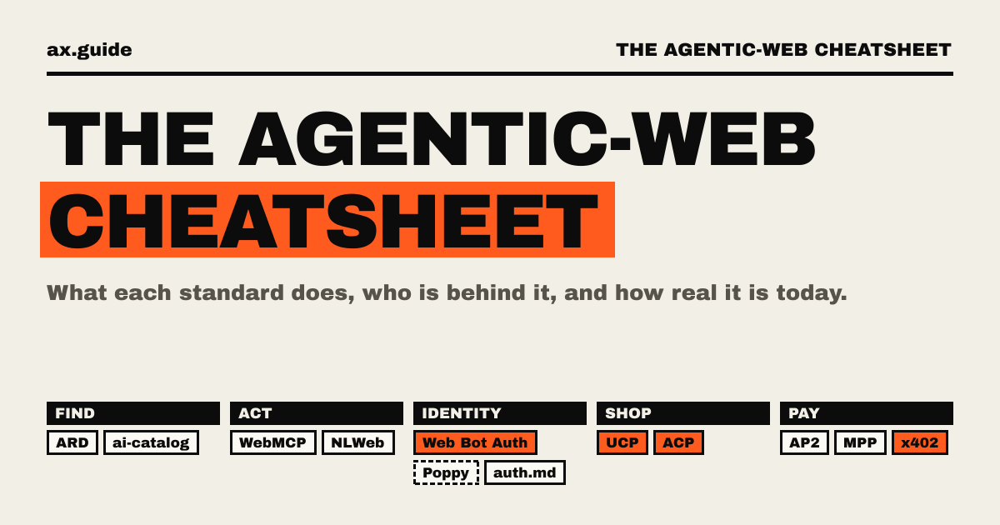
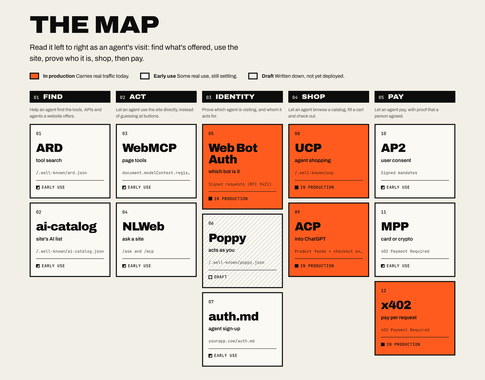
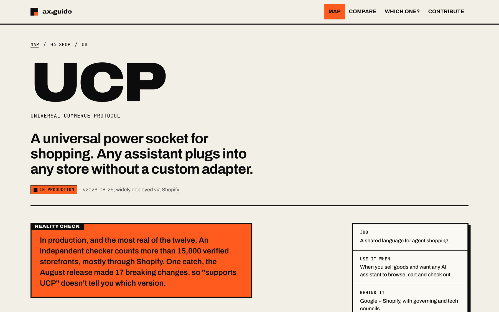
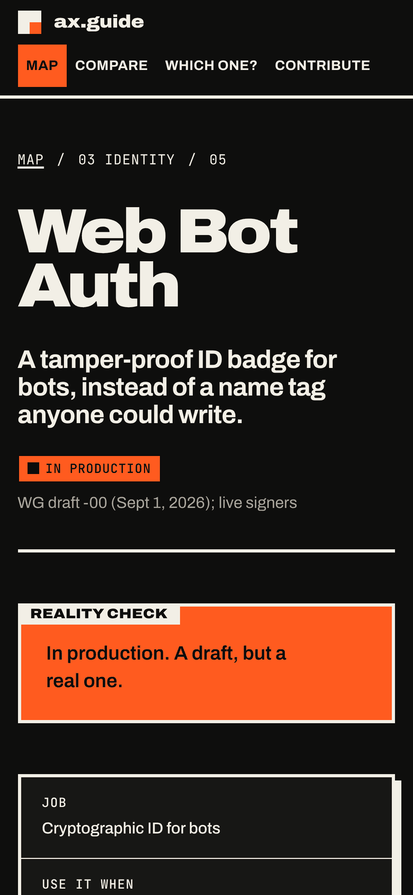

<p align="center">
  <a href="https://ax.guide"></a>
</p>

<p align="center">
  <a href="https://ax.guide"></a>
  <a href="https://github.com/ora/standards/actions/workflows/ci.yml"></a>
  <a href="LICENSE"></a>
  <a href="content/LICENSE"></a>
  <a href="CONTRIBUTING.md"></a>
</p>

# ax.guide

**The Agentic-Web Cheatsheet.** An open, plain-language guide to the standards that let AI agents **find**, **use**, **sign in to**, **shop on** and **pay** websites. For each one: what it does, who's behind it, and how real it is today.

Agents are the new browsers. Since mid-2025 a dozen open standards have appeared to teach websites how to deal with them. They're young, they overlap, several are only drafts, and the press releases make all of them sound finished. ax.guide puts the whole map in one place, and keeps it honest: a standard is marked **in production** only when there is public evidence of real traffic.

**Read it at [ax.guide](https://ax.guide).** Every page is a Markdown file in this repository, so anyone can fix a sentence or add a standard with a pull request.

## The map

Read it left to right as an agent's visit: find what's offered, use the site, prove who it is, shop, then pay. Orange means real traffic today, plain means early use, and hatched means a draft.

<a href="https://ax.guide/#map"></a>

## The standards

<!-- standards:start (generated from content/standards; run `npm run readme` to update) -->
| # | Standard | Job | In one phrase |
| --- | --- | --- | --- |
| 01 | **[ARD](https://ax.guide/standards/ard)**<br>Agentic Resource Discovery | Find | Search for agent tools across the web |
| 02 | **[ai-catalog](https://ax.guide/standards/ai-catalog)**<br>AI Catalog | Find | A site's list of its AI offerings |
| 03 | **[WebMCP](https://ax.guide/standards/webmcp)** | Act | A page hands typed tools to the agent in your browser |
| 04 | **[NLWeb](https://ax.guide/standards/nlweb)** | Act | Ask a website questions in plain language |
| 05 | **[Web Bot Auth](https://ax.guide/standards/web-bot-auth)** | Identity | Cryptographic ID for bots |
| 06 | **[Poppy](https://ax.guide/standards/poppy)**<br>Personal Agent Protocol (PAP) | Identity | Your agent signs in to a company as you |
| 07 | **[auth.md](https://ax.guide/standards/auth-md)** | Identity | Your agent signs you up for a new service |
| 08 | **[UCP](https://ax.guide/standards/ucp)**<br>Universal Commerce Protocol | Shop | A shared language for agent shopping |
| 09 | **[ACP](https://ax.guide/standards/acp)**<br>Agentic Commerce Protocol | Shop | Products (and checkout) into ChatGPT |
| 10 | **[AP2](https://ax.guide/standards/ap2)**<br>Agent Payments Protocol | Pay | Signed proof of what you authorized |
| 11 | **[MPP](https://ax.guide/standards/mpp)**<br>Machine Payments Protocol | Pay | Pay inside a web request, card or crypto |
| 12 | **[x402](https://ax.guide/standards/x402)** | Pay | Cents-per-request payments over HTTP 402 |
<!-- standards:end -->

Each page has a one-line picture of the standard, a **reality check**, how it works, who's behind it, primary sources, the standards it's often confused with, and the date someone last checked it. The site also has a [side-by-side comparison](https://ax.guide/compare) and a [which-one-do-I-need guide](https://ax.guide/which).

<table>
  <tr>
    <td width="68%"><a href="https://ax.guide/standards/ucp"></a></td>
    <td width="32%"><a href="https://ax.guide/standards/web-bot-auth"></a></td>
  </tr>
</table>

## Contributing

These standards change every month, so the guide stays right only if people fix it. The most useful contributions, roughly in order:

1. **Correct a fact or a status.** Open the standard's page, press **Edit on GitHub**, change the line and link your source.
2. **Re-verify a page.** Check every claim against its sources and bump `last_verified`. Pages unchecked for 90 days are marked as possibly out of date.
3. **Add a standard.** Copy [`content/standards/_template.md`](content/standards/_template.md), fill it in, and open a pull request.

Please read [CONTRIBUTING.md](CONTRIBUTING.md) first: it covers the status rules (a partner list is not adoption), sourcing and house style. Not sure about a change? [Report an error](https://github.com/ora/standards/issues/new?template=correction.yml) or [suggest a standard](https://github.com/ora/standards/issues/new?template=new-standard.yml) instead.

## How it's built

A small [Next.js](https://nextjs.org) app with no backend, no database and no tracking. Every page is static, built from the files in [`content/`](content/).

```
content/
  standards/<id>.md        one file per standard: checked front matter + Markdown
  standards/_template.md   copy this to add a standard
  jobs.json                the five jobs, in map order
  pairs.json               the pairs people mix up (/compare)
  guide.json               which one do I need (/which)
  home.json, site.json     page text: titles, nav, footer, status labels
  contribute.md            the /contribute page
lib/schema.ts              the rules every standard's front matter must follow
lib/standards.ts           reads, checks and numbers the standards
app/                       pages and share images (Next.js App Router)
components/                small presentational components
tests/                     checks every content file and this README's table
```

The build and the tests check every content file: a missing field, an unknown status, a broken link between standards or an em dash fails CI and names the file.

### Run it locally

You need Node 22 (see [`.nvmrc`](.nvmrc)) and npm.

```sh
npm install
npm run dev          # http://localhost:3000
```

| Script | What it does |
| --- | --- |
| `npm run dev` | Development server |
| `npm run build` | Production build; fails if any content file is invalid |
| `npm test` | Content and unit tests |
| `npm run lint` | ESLint |
| `npm run typecheck` | TypeScript |
| `npm run readme` | Regenerate the table of standards in this README |

### Deploy

It runs on Vercel with no settings: import the repository and keep the defaults, and every pull request gets a preview. Canonical links and share images use the preview's own address on previews, then `NEXT_PUBLIC_SITE_URL` (`https://ax.guide` in production), then Vercel's production address.

## License

- **Code:** [MIT](LICENSE).
- **Words** in [`content/`](content/): [CC BY 4.0](content/LICENSE). Reuse them anywhere, with credit.
- **Fonts:** Archivo and JetBrains Mono, both under the SIL Open Font License; the share images use [Archivo Black](assets/fonts/OFL.txt).

Maintained by [Ora](https://ora.ai) and [contributors](https://github.com/ora/standards/graphs/contributors). Security issues: see [SECURITY.md](SECURITY.md).
